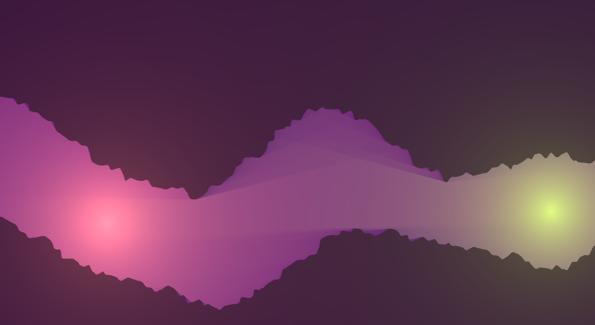
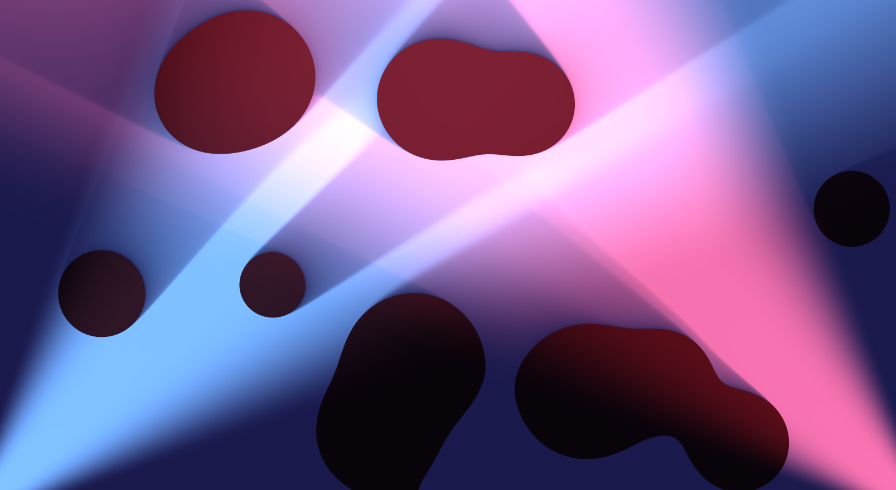
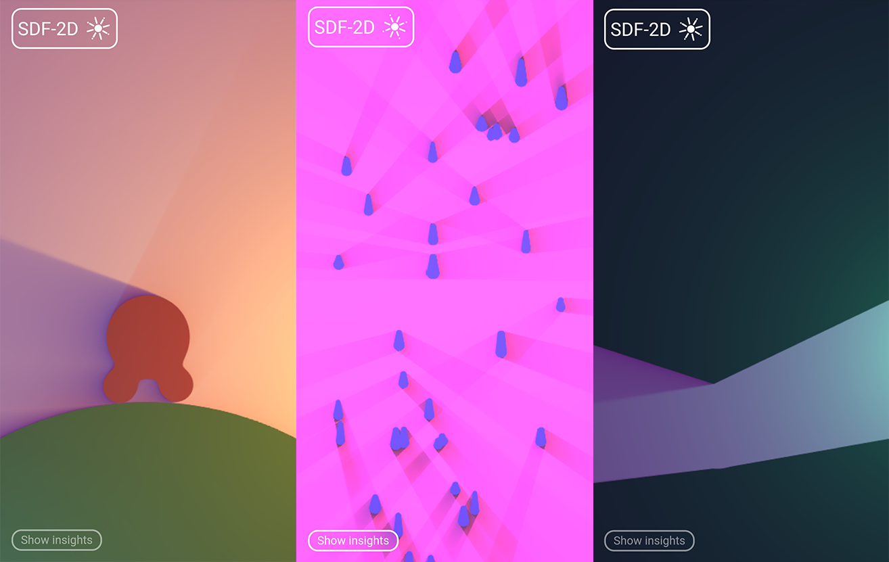

#  SDF-2D library

A graphics library for real-time rendering of 2D signed distance fields on the web.





## Links

- [View it in action (demos)](https://sdf2d.schmelczer.dev)
- [View it in action (video game)](https://doppler.schmelczer.dev/)
- [Documentation](https://sdf-2d-docs.schmelczer.dev/)
- [In-depth information](https://schmelczer.dev/media/downloads/sdf2d-andras-schmelczer.pdf)

## Features

- Works with both WebGL and WebGL2
  > The former is mainly needed to support older iPhones.
- Performant even on low-end mobile devices
  > Try it out yourself!
- Comes with a number of built-in shapes and lights
- Easily extensible with new shapes
- Antialiasing is built in
- Built-in quality autoscaling
- Requires no boilerplate code
  - WebGL and its extensions are detected automatically
  - Shaders are compiled in parallel, without blocking
  - Context loss is handled with automatic restoration
  - Can be used without thinking about the GPU _(although for stunning results, it should be kept in mind)_



> Four separate screenshots taken on a mobile device

## Install

```sh
npm install sdf-2d --save-dev
```

## Use

```js
import { compile, CircleFactory, hsl, CircleLight } from 'sdf-2d';

const main = async () => {
  const Circle = CircleFactory(hsl(30, 66, 50));
  const canvas = document.querySelector('canvas');

  const renderer = await compile(canvas, [Circle.descriptor, CircleLight.descriptor]);

  renderer.addDrawable(new Circle([200, 200], 50));
  renderer.addDrawable(new CircleLight([500, 300], [1, 0.5, 0], 0.5));
  renderer.renderDrawables();
};

main();
```

## Examples

For further examples, please visit the following repositories:

- [Source for the demo page](https://git.schmelczer.dev/andras/sdf-2d-demo)
- [Source for decla.red, the multiplayer game](https://git.schmelczer.dev/andras/decla-red)

## Building the documentation

Run `npm run docs` to regenerate `docs/`, or `npm run build` to build both the library and documentation. Documentation warnings fail the build, including unresolved `{@link Symbol}` references. Use these references for API links in source comments and `documentation-readme.md` so TypeDoc can validate them.

`typedoc.json` selects the public modules exported by `src/main.ts`, along with the settings, defaults, and renderer information used by their signatures. Keep these entry points aligned when adding public APIs. The module layout preserves existing API URLs while leaving internal implementation modules out of navigation.

The factory return types listed in `intentionallyNotExported` are private implementation types. Their constructor signatures, arguments, and examples are documented on each factory page instead of exporting the base classes. Keep that guidance up to date when changing a factory's constructor.

## Documentation

For more technical details, please consult the documentation available in the repository and at [sdf-2d-docs.schmelczer.dev/](https://sdf-2d-docs.schmelczer.dev/).

## Plans

- Automatic tile multiplier scaling
- Non-uniform tile sizes based on scene density
